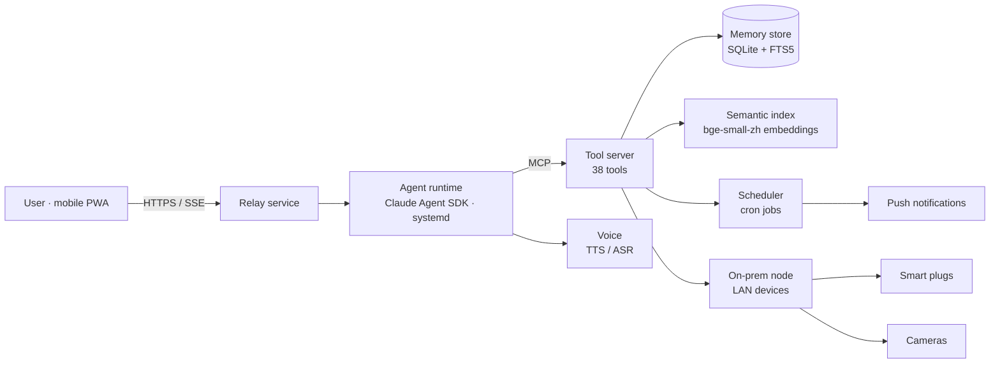

# Personal AI Agent Infrastructure

A self-hosted platform that gives a large-language-model assistant **long-term memory, its own tool server, scheduled autonomy, and connections to real devices** — built around an explicit **risk and governance model** (privacy, security, auditability, and human control).

> **My role:** founder and product owner. I defined the requirements, designed the system and its risk controls, and directed implementation with AI coding agents (Claude). The project has been in continuous daily use since March 2026.

---

## Why

Off-the-shelf chat assistants forget everything between sessions and can't act outside the chat window. I wanted an assistant that remembers context over months, can act on real systems, and stays safe to operate: every capability had to come with a control.

## Architecture



| Layer | What it does |
|---|---|
| **Client** | Installable PWA: streaming chat, voice messages, photo upload, live "agent is working" indicator, visible tool-activity log |
| **Relay** | Authenticated message broker between client and agent; server-sent events; web push |
| **Agent runtime** | Long-running agent process with session persistence, context-window management and handoff notes, prompt-cache keep-warm for cost control |
| **Tool server (MCP)** | 38 purpose-built tools: memory read/write/search, scheduling, notifications, email, device control, calendar, journaling |
| **Memory** | Typed long-term store (facts, preferences, events, notes) with tiered retention, full-text search, and semantic retrieval |
| **Automation** | 15+ scheduled jobs: memory decay, nightly backups, index rebuilds, health checks, proactive check-ins |
| **Devices** | Local-network control of smart plugs and read-only camera snapshots through an on-prem node |
| **Voice** | Text-to-speech for calls; local speech recognition (faster-whisper) for voice messages |

## Memory system

- **Typed records** — stable facts, preferences, events, short-lived notes, and journals are stored as different types with different lifecycles.
- **Tiered retention** — an importance score (1–5) maps to a lifetime of 3 / 14 / 60 / 365 days or permanent. Expiry removes a record from the agent's default context *without deleting it*, so it stays searchable.
- **Scheduled decay** — a daily job lowers the importance of aging long-form entries, so recent context stays prominent.
- **Hybrid retrieval** — exact-term search (SQLite FTS5) plus semantic search (512-d `bge-small-zh-v1.5` embeddings, cosine similarity, incremental indexing of new records).
- **Usage credit** — retrieved records the agent actually used are logged, to support evidence-based archiving of unused memories.

See [`src/memory`](src/memory) for simplified reference implementations.

## Risk & governance

The design treats the agent as a privileged system that needs controls, not just features. Full control matrix: [`docs/risk-and-governance.md`](docs/risk-and-governance.md).

| Risk | Control |
|---|---|
| **Prompt injection / spoofed user input** | Inputs carrying role prefixes or system tags are treated as untrusted *regardless of content*; the agent must reconcile any suspicious message against the relay's message log before acting, and discard it if it isn't there |
| **Agent acting on stale instructions** | User messages sent while a long action is running are delivered mid-action, and are checked *before* any external side effect (orders, emails, calls) |
| **False "done" claims** | Completion may only be reported after a successful tool receipt; failures are reported as failures |
| **Credential exposure** | No secrets in code, repos, or command lines; secrets are delivered through a dedicated authenticated drop endpoint; credentials found in an old repository's history were rotated the same day |
| **Unauthenticated endpoints** | A periodic review found several open service routes; all were put behind authentication and tested one by one |
| **Privacy of camera / location data** | The user holds the off-switch; camera frames are viewed in memory and never stored; location is shared only when the user triggers it |
| **Uncontrolled spending** | Purchases limited to pre-authorised categories, only on explicit request, with price-anomaly checks and a stated summary before confirmation |
| **Change risk** | Every change: backup → syntax check → isolated test → announce → restart; restarts of core services require explicit approval |
| **Data loss** | Daily database backups, pre-change snapshots, a written "loss register" for anything unrecoverable |

## Repository contents

```
docs/risk-and-governance.md   control matrix and incident notes
src/memory/retention.py       tiered retention and decay
src/memory/retrieval.py       hybrid full-text + semantic retrieval
src/security/reconcile.py     provenance check for inbound messages
src/util/timewindow.py        timezone-safe query windows
```

The production system contains personal data and is private. This repository holds sanitized, simplified versions of key components to illustrate the design.

## Stack

Python · Node.js · SQLite (FTS5) · fastembed / BGE embeddings · Model Context Protocol · Claude Agent SDK · systemd · cron · Nginx · Cloudflare · PWA (service worker, SSE, web push) · ElevenLabs TTS · faster-whisper

---

Xinyi (Chloe) Wu · M.S. Enterprise Risk Management, Columbia University
